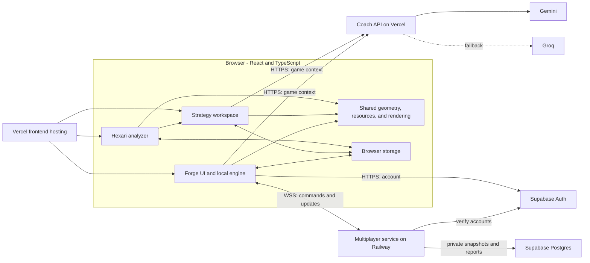
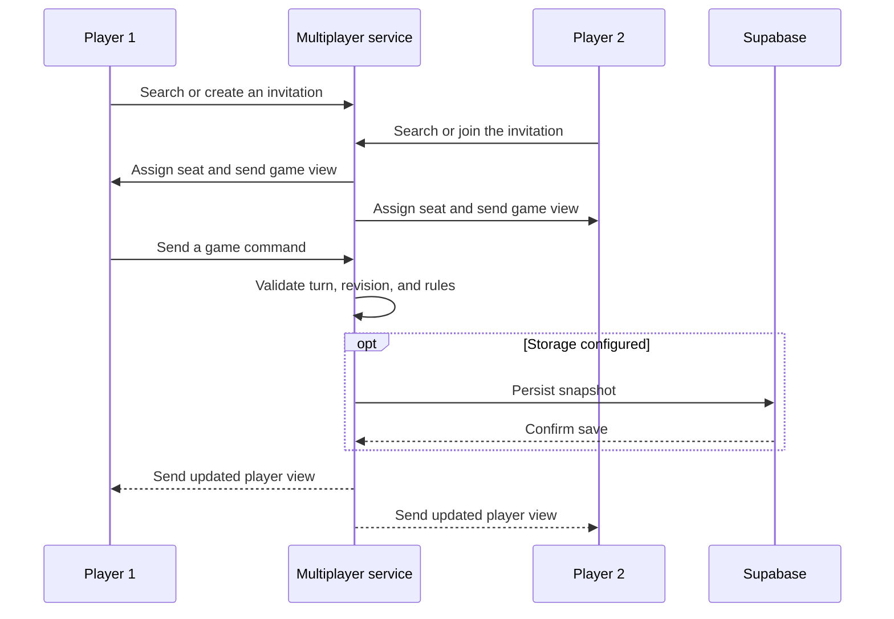

# Hexari

> A board intelligence workspace and a two-player strategy game, built for the browser.

[Open Hexari](https://hexari.hirusha.space/) | [Play Forge](https://forge.hirusha.space/) | [Local setup](#quick-start) | [Architecture](#architecture) | [Deployment](#deployment)

Hexari brings board analysis, game tracking, trade evaluation, statistics, and AI coaching together around a shared board. Forge is a separate two-player game with its own board and rules. Both applications share rendering, design, and coaching infrastructure.


## Contents

- [Explore the applications](#explore-the-applications)
- [Product motivation](#product-motivation)
- [Try each module](#try-each-module)
- [How the applications work](#how-the-applications-work)
- [Architecture](#architecture)
- [Technical decisions](#technical-decisions)
- [Technology](#technology)
- [Project structure](#project-structure)
- [Quick start](#quick-start)
- [Configuration](#configuration)
- [Online play and accounts](#online-play-and-accounts)
- [API reference](#api-reference)
- [Testing and quality](#testing-and-quality)
- [Deployment](#deployment)
- [Security and operations](#security-and-operations)
- [License](#license)

## Explore the applications

| Surface            | Production address                                               | Purpose                                                                                 |
| ------------------ | ---------------------------------------------------------------- | --------------------------------------------------------------------------------------- |
| Board analyzer     | [hexari.hirusha.space](https://hexari.hirusha.space/)            | Edit a board, analyze production, compare opening positions, and share a configuration. |
| Strategy workspace | [hexari.hirusha.space/tools](https://hexari.hirusha.space/tools) | Track a game, evaluate trades, request coaching, and explore statistics.                |
| Forge              | [forge.hirusha.space](https://forge.hirusha.space/)              | Play against a bot, on one device, or online against another player.                    |

The combined local app serves the same surfaces at `/`, `/tools`, and `/forge`. The standalone Forge entry serves the game at `/`.

## Product motivation

A promising intersection can have strong production yet leave a player short of a needed resource or too far from a useful port. Comparing those trade-offs by eye becomes harder once dice rolls, builds, and trades change the position. Hexari puts the board and those decisions in one workspace, with uncertainty visible when information is missing.

Forge explores a shorter game with a fixed opening, a five-point target, and a hand cap. Those choices are a design hypothesis about pace, not a claim that a specific game duration has been established by player testing.

## Try each module

| Module               | Interactive walkthrough                                                                                                              |
| -------------------- | ------------------------------------------------------------------------------------------------------------------------------------ |
| Board analyzer       | [Edit a board](https://hexari.hirusha.space/), then change a terrain tile or number and inspect its production map.                  |
| Settlement optimizer | [Open the analyzer](https://hexari.hirusha.space/), select a corner, and compare it with the ranked alternatives.                    |
| Live tracker         | [Open the workspace](https://hexari.hirusha.space/tools), enter player positions and record dice rolls or actions.                   |
| Trade calculator     | [Open the workspace](https://hexari.hirusha.space/tools), set a hand and goal, and compare an offer with the bank rate.              |
| AI coach             | [Open the workspace](https://hexari.hirusha.space/tools), enter a visible position and request advice when a provider is configured. |
| Board stats          | [Open the workspace](https://hexari.hirusha.space/tools) to inspect production, opening opportunities, and modelled strategy races.  |
| Forge                | [Play Forge](https://forge.hirusha.space/) against the bot or another player.                                                        |

The links open the interactive applications. Recorded demonstrations and module GIFs are not included here.

## How the applications work

### Hexari

1. **Build a board.** Choose terrain, number tokens, and ports on a 19-tile board. The editor validates the configuration and offers a bounded balancing search based on a simulated four-seat opening draft.
2. **Analyze openings.** Rank the 54 intersections using production, resource diversity, port access, and strategy. Compare up to three corners and filter illegal second placements.
3. **Continue in the workspace.** Log rolls and actions, estimate hands, evaluate offers against a hand and goal, and inspect production and strategy simulations.
4. **Share the board.** The encoded configuration travels in the URL hash and is saved in browser storage. The analyzer and workspace use that configuration, including editable ports.

The tracker models recorded trades, buildings, robber movement, discards, development-card effects, and uncertain steals. Its results depend on the starting position and the actions entered. A tracked player's position can be sent to the trade calculator and coach; an uncertain hand is not presented as known.

Scores, balance searches, trade ranges, and strategy races are heuristics or simulations. They describe opportunity under their stated assumptions, not measured win probabilities or guarantees of fairness.

### Forge

Forge is a two-player game on a fixed 37-tile board. Each player starts with a predetermined settlement and one of each resource. Roll, collect, trade, and build to reach **five victory points**.

- Play against a bot, share one device, or find an online opponent.
- Build roads and settlements, or upgrade a settlement to a city. A successful build ends the turn.
- Trade with the other player or exchange four matching resources with the bank for one different resource.
- Hold up to seven cards. On a roll of seven, each player with space receives one of their least-held resources. Each turn has a two-minute timer.
- Earn two points for the longest continuous road of at least five segments. An opponent's building interrupts a road; the current holder retains the award in a tie.
- Use the in-game guide, coaching, sound and appearance settings, and game controls while playing.

Online games add matchmaking, invitations, chat, reporting, reconnection, and optional accounts. Guests use generated nicknames; signed-in players use their account display names.

### AI coach

Hexari and Forge send the visible game context to `POST /api/coach`. The server validates the request and streams advice from Gemini, with Groq as a fallback when configured and the primary provider fails before streaming advice. Provider credentials remain server-side.

Hexari keeps recent board-specific coaching in local browser storage. Forge keeps recent coaching per player for local games and per room in the current browser tab for online games.

## Architecture



The combined Vite entry point selects a surface from the current host and path. `src/shared/board.ts` supplies the shared Hexari board model, geometry, ports, and encoding. PixiJS draws terrain while SVG controls provide interaction. Forge uses a separate board and game engine.

The multiplayer service is a long-running Node.js process. It assigns dice, validates commands and revisions using the Forge rules, and sends each player a view with the opponent's hand hidden. Active connections and matchmaking are held in memory. With Supabase configured, private room snapshots and chat reports are persisted in server-only tables.



A disconnected player has a 60-second reconnection grace period. Account-linked unfinished rooms can be recovered while the room remains within its two-hour lifetime. Guest reconnection uses credentials stored in the browser tab. The in-memory queue and active-room coordination use one service instance.

## Technical decisions

- **PixiJS terrain with SVG controls:** PixiJS renders the board artwork while SVG controls expose selectable tiles and corners to the browser. This keeps the visual layer separate from interaction semantics.
- **Explicit game phases:** Forge keeps rules and transitions in its TypeScript engine, separate from React rendering. The current phases cover setup, rolling, building, and the game end; server commands use the same rules.
- **Client-side analysis with dedicated services where needed:** Board calculations run in the browser. The coach uses a server function to keep provider credentials private, and online play uses a separate authoritative WebSocket service for matchmaking, game commands, and reconnection.
- **Heuristics with stated limits:** Opening scores, suggested trade ranges, and strategy simulations surface their assumptions instead of presenting their outputs as observed win rates.

## Technology

| Layer                    | Technology                                                                  |
| ------------------------ | --------------------------------------------------------------------------- |
| Application              | React 18, TypeScript, Vite                                                  |
| Board rendering          | PixiJS 8, SVG, CSS                                                          |
| Game and strategy        | TypeScript rules, scoring, tracking, and simulations                        |
| AI coaching              | Node.js function, Gemini, Groq, server-sent events                          |
| Online game              | Node.js, `ws` WebSockets                                                    |
| Accounts and persistence | Supabase Auth, PostgreSQL, browser storage                                  |
| Quality and delivery     | Vitest, Node test runner, ESLint, Prettier, GitHub Actions, Vercel, Railway |

## Project structure

```text
hexari/
|-- api/coach.ts             Coach HTTP endpoint
|-- apps/forge/              Standalone Forge entry point
|-- server/                  Multiplayer, identity, storage, and moderation
|-- src/
|   |-- forge/               Game UI, rules, bot, online protocol, and audio
|   |-- hexari/              Analyzer, workspace, and strategy engines
|   |-- server/              Coach streaming, validation support, and Vite middleware
|   +-- shared/              Board model, rendering, resources, and shared UI
|-- supabase/forge.sql       Room and report tables and access controls
|-- tests/                   Unit, integration, and multiplayer tests
|-- .github/workflows/       Verification and deployment workflows
|-- .env.example             Environment variable template
|-- vite.config.ts           Combined application configuration
|-- vite.forge.config.ts     Standalone Forge configuration
+-- vercel.json              Routing and response headers
```

## Quick start

### Prerequisites

- Node.js 22.12 or later in the Node 22 release line, Node 24, or Node 26+, and npm. CI uses Node 22 and 26.
- A modern browser.
- A Gemini or Groq key for coaching. Local analysis and local Forge do not require one.
- A separate WebSocket process for online Forge. Supabase adds accounts and durable room storage.

### Install and run

```powershell
git clone https://github.com/hellohirusha/hexari.git
cd hexari
npm ci
Copy-Item .env.example .env.local
npm run dev
```

Open the URL printed by Vite. To run Forge as a standalone app, use `npm run dev:forge`. On macOS or Linux, use `cp .env.example .env.local` instead of `Copy-Item`.

Add optional credentials to `.env.local` before starting the relevant process. Restart Vite after changing its variables. The file is ignored by Git and must stay private.

<details>
<summary>Try online play on one computer</summary>

Start the browser app with `npm run dev` and, in another terminal, start the service with `npm run multiplayer`. Open Forge in two separate browser sessions and select **Start game > Online 1 vs. 1** in each. The local client connects to `ws://localhost:8787/forge` by default.

For account features and persistent rooms, configure Supabase as described below. The service defaults to allowing `http://localhost:5173` and `http://127.0.0.1:5173`; add the exact app origin to `FORGE_ALLOWED_ORIGINS` if Vite chooses another port.

</details>

## Configuration

`.env.example` lists the values used by the app and multiplayer service. The `VITE_` prefix exposes a value in the browser bundle. Never use it for secret keys.

### Browser application

| Variable                        | Purpose                                                                                                                      |
| ------------------------------- | ---------------------------------------------------------------------------------------------------------------------------- |
| `VITE_FORGE_SERVER_URL`         | WebSocket endpoint ending in `/forge`. Use `wss://` for a hosted app, for example `wss://railway-forge.hirusha.space/forge`. |
| `VITE_SUPABASE_URL`             | Public Supabase project URL for accounts.                                                                                    |
| `VITE_SUPABASE_PUBLISHABLE_KEY` | Supabase publishable key for accounts.                                                                                       |

Set browser variables before starting Vite or building for deployment. Rebuild and redeploy after changing them. The local endpoint in `.env.example` is for local development, not a hosted deployment.

### Coach server

| Variable                        | Purpose                                                              |
| ------------------------------- | -------------------------------------------------------------------- |
| `GEMINI_API_KEY`                | Gemini credential. The coach prefers Gemini when configured.         |
| `GEMINI_MODEL`                  | Optional Gemini model override; code default is `gemini-3.8-flash`.  |
| `GROQ_API_KEY`                  | Groq credential, used as the only provider or as a backup.           |
| `GROQ_MODEL`                    | Optional Groq model override; code default is `openai/gpt-oss-120b`. |
| `COACH_MAX_REQUESTS_PER_MINUTE` | Per-client, per-process limit; default `15`.                         |
| `COACH_MAX_REQUESTS_PER_HOUR`   | Combined per-process limit; default `200`.                           |

Configure at least one provider key for coaching. Store these values in `.env.local` for development and in the Vercel server environment for deployment. Verify model availability and provider quotas for the account being used.

### Multiplayer service

| Variable                   | Purpose                                                                  |
| -------------------------- | ------------------------------------------------------------------------ |
| `SUPABASE_URL`             | Supabase project URL for storage and account verification.               |
| `SUPABASE_PUBLISHABLE_KEY` | Publishable key used by the server to verify account tokens.             |
| `SUPABASE_SECRET_KEY`      | Server-only key for room snapshots and reports.                          |
| `FORGE_ALLOWED_ORIGINS`    | Comma-separated browser origins allowed to connect.                      |
| `FORGE_MODERATOR_TOKEN`    | Server-only bearer token for reviewing reports.                          |
| `FORGE_STORAGE_TIMEOUT_MS` | Database request timeout; default `10000` milliseconds.                  |
| `PORT`                     | Service listening port; default `8787`. Hosting providers may supply it. |

Keep the Supabase secret key, moderator token, and provider keys out of source control and browser variables. The browser and service use the same Supabase URL and publishable key, under their respective variable names.

## Online play and accounts

### Supabase setup

1. Create a project in the [Supabase dashboard](https://supabase.com/dashboard). Copy its project URL, publishable key, and server secret key.
2. Run [`supabase/forge.sql`](supabase/forge.sql) in the project's SQL editor. It creates the room and report tables, enables row-level security, and restricts table access to the service role.
3. In Supabase Auth, enable email confirmation. Set the site URL to `https://forge.hirusha.space/` and allow these redirect URLs:

   ```text
   https://forge.hirusha.space/?account=confirm
   https://forge.hirusha.space/?account=recovery
   ```

   For local testing, also allow the exact development origin and path, for example `http://localhost:5173/forge?account=confirm` and the equivalent `account=recovery` URL.

4. Configure custom SMTP in Supabase Auth for public registration and password recovery. Verify the sending domain with the email provider and enter its SMTP credentials in Supabase, not in the browser app.
5. Set the browser and multiplayer variables from the tables above. Run the app and service, then test matching, account confirmation, and recovery with separate browser sessions.

<details>
<summary>Configure a custom confirmation email sender</summary>

To send as `Forge <forge@hirusha.space>` using Resend:

1. Add `hirusha.space` under **Domains** in Resend with sending enabled. Add the exact DNS records Resend provides at the domain's DNS host, then verify the domain in Resend. Keep existing website and mail records; avoid duplicate SPF records at the same hostname.
2. Create a Resend API key with sending access restricted to the verified domain.
3. In Supabase, open **Authentication > Emails > SMTP Settings** and enable custom SMTP:

   | Setting      | Value                 |
   | ------------ | --------------------- |
   | Sender email | `forge@hirusha.space` |
   | Sender name  | `Forge`               |
   | Host         | `smtp.resend.com`     |
   | Port         | `465`                 |
   | Username     | `resend`              |
   | Password     | The Resend API key    |

4. Keep the standard confirmation link in the Supabase email template and disable provider link tracking if enabled. Test confirmation and password recovery with a real account after deployment.

Store the SMTP key in Supabase, not in a `VITE_` variable. A sender address does not by itself create an inbox for replies. See [Supabase SMTP setup](https://supabase.com/docs/guides/auth/auth-smtp), [Resend SMTP settings](https://resend.com/changelog/smtp-service), and [Vercel DNS records](https://vercel.com/docs/domains/managing-dns-records).

</details>

After email confirmation in another tab of the same browser profile and origin, Supabase synchronizes the session. The waiting Forge welcome page reloads once; an active game updates the account without a forced reload. A different device or browser profile does not share the original tab's session.

### Local and hosted service

The client connects to the Node service over WebSockets. For hosted play, run one long-lived service with `npm run multiplayer`, expose HTTPS and secure WebSockets, and set `FORGE_ALLOWED_ORIGINS` to exact browser origins such as `https://forge.hirusha.space`. Set `VITE_FORGE_SERVER_URL` to the public `wss://.../forge` address before building the browser app.

Use `/health` for a process liveness check. `/ready` checks configured room-storage access and the presence of an account publishable key; it is not a complete verification of authentication or email delivery. Supabase persistence uses private server credentials. Without it, guest rooms and reports are held in process memory.

Open `/moderation` on the service to review reports using the configured moderator token. Report review marks a report as reviewed; it does not automatically block a player.

## API reference

| Endpoint                          | Service                            | Purpose                                                                        |
| --------------------------------- | ---------------------------------- | ------------------------------------------------------------------------------ |
| `POST /api/coach`                 | Vercel function or Vite middleware | Validate game context and return AI advice, including streamed responses.      |
| `GET /health`                     | Multiplayer                        | Check that the service process is running.                                     |
| `GET /ready`                      | Multiplayer                        | Check room-storage access and publishable-key presence.                        |
| `GET /moderation`                 | Multiplayer                        | Open the report-review interface.                                              |
| `GET /moderation/reports`         | Multiplayer                        | Retrieve reports with the moderator bearer token.                              |
| `POST /moderation/reports/review` | Multiplayer                        | Mark a report reviewed with the moderator bearer token.                        |
| `WS /forge`                       | Multiplayer                        | Match players and exchange commands, game views, chat, and reconnect messages. |

The coach accepts structured board and player context. Its provider calls and response formatting live in [`api/coach.ts`](api/coach.ts) and [`src/server/`](src/server/). The multiplayer routes belong to the separate Node service, not the Vercel coach function.

## Testing and quality

```powershell
npm run lint
npm run format
npm test
npm run test:multiplayer
npm run build
npm run build:forge
```

| Command                    | Coverage                                                         |
| -------------------------- | ---------------------------------------------------------------- |
| `npm run lint`             | ESLint and TypeScript.                                           |
| `npm run format`           | Prettier formatting check.                                       |
| `npm test`                 | Vitest unit and integration tests.                               |
| `npm run test:multiplayer` | Local WebSocket scenarios, including a complete controlled game. |
| `npm run build`            | Type-check and build the combined app into `dist/`.              |
| `npm run build:forge`      | Type-check and build standalone Forge into `dist-forge/`.        |

The coach integration tests simulate provider responses. Multiplayer tests use local clients and a local service. For a deployed system, also exercise registration, email confirmation, coaching, matchmaking, chat, and reconnection with the configured services and two browser sessions.

## Deployment

### Vercel

Deploy the repository root with `npm run build` and output directory `dist`. Vercel serves the combined app and `api/coach.ts`. Configure the browser variables and coach keys for the intended Vercel environment. `vercel.json` configures response headers and routing; the canonical Forge address is `https://forge.hirusha.space/`.

### Railway

Run the multiplayer service as a separate Node process with start command `npm run multiplayer`. Configure its server variables in Railway, expose its port, set a health check on `/health`, and point the Vercel browser build at its public secure WebSocket URL. Vercel does not start the multiplayer process.

### GitHub Actions

[CI](.github/workflows/ci.yml) runs installation, lint, formatting, tests, multiplayer scenarios, and both builds on pushes and pull requests using Node 22 and 26. After all checks pass on `main`, it confirms that the commit is the current `main` head and resulted from a merged pull request before calling the [production deployment workflow](.github/workflows/cd.yml). Both services deploy the same verified commit. Direct pushes and stale commits do not qualify.

Vercel Git auto-deployments are disabled in `vercel.json` so GitHub Actions controls deployments. In Railway, open the multiplayer service's **Settings > Source** and disable GitHub auto-deployments as well; otherwise Railway can deploy independently of CI. Require pull requests for changes to `main` and prohibit force pushes in GitHub branch protection. Manual deployments and deploy hooks are separate deployment paths and must be restricted or removed if production releases should only come from this workflow.

Configure these GitHub Actions values:

| Kind     | Name                     |
| -------- | ------------------------ |
| Secret   | `VERCEL_ORG_ID`          |
| Secret   | `VERCEL_PROJECT_ID`      |
| Secret   | `VERCEL_TOKEN`           |
| Secret   | `RAILWAY_API_TOKEN`      |
| Variable | `RAILWAY_PROJECT_ID`     |
| Variable | `RAILWAY_ENVIRONMENT_ID` |
| Variable | `RAILWAY_SERVICE_ID`     |

The workflow uses the GitHub environments `production` and `forge-multiplayer / production`. Configure their protection rules and access to secrets as appropriate. Service runtime variables belong in Vercel or Railway; GitHub deployment credentials are separate.

### Standalone Forge

Use `npm run build:forge` and publish `dist-forge` for the standalone frontend. The coach endpoint must also be hosted and routed if that deployment uses coaching. `npm run preview:forge` previews static files; use the Vite development server when testing its local coach middleware.

## Security and operations

- The browser bundle contains public Vite values. Keep AI keys, Supabase secret keys, and moderator tokens in server environments.
- Restrict WebSocket origins and use TLS in production. Apply connection and request limits at the hosting edge.
- The coach's built-in rate limits are per process, not a shared global quota. Configure an edge limit and provider usage or spending controls for public traffic.
- The multiplayer queue and active connections are process-local. Use one instance unless shared coordination is introduced.
- Monitor service health, provider usage, email delivery, and report handling. Keep dependencies updated and review deployment credentials.
- Board data, settings, local games, tracker state, and local coaching history are tied to browser storage and origin. Clearing storage can remove them.

## License

Hexari is licensed under the [MIT License](LICENSE). See the [audio credits](src/forge/assets/audio/CREDITS.md) for sound attribution.
