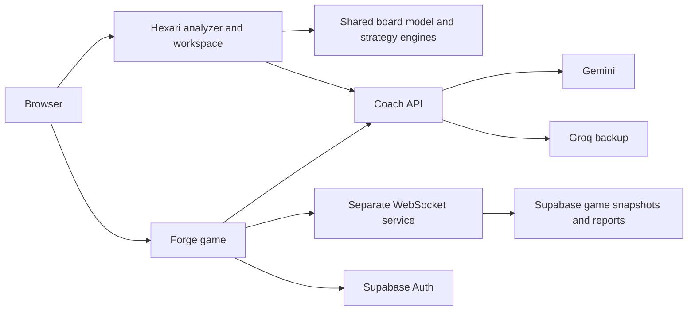

# Hexari

> A browser-based strategy companion for analyzing hex boards and improving
> play, with Forge, a fast two-player strategy game.
> Built with React, TypeScript, Vite, PixiJS, and Node.js.

## How it works

Hexari brings board analysis, game tracking, trading, and coaching together
around one shared board configuration. Forge is a separate game with its own
fixed board and simplified rules.

| Surface                | Address                                                         | What you can do                                                                              |
| ---------------------- | --------------------------------------------------------------- | -------------------------------------------------------------------------------------------- |
| **Board analyzer**     | [Hexari home](https://hexari.hirusha.space/)                    | Configure tiles, number tokens, and ports; rank and compare starting intersections           |
| **Strategy workspace** | [Hexari strategy workspace](https://hexari.hirusha.space/tools) | Track a session, evaluate trades, request coaching, and explore board statistics             |
| **Forge**              | [Forge](https://hexari.hirusha.space/forge)                     | Play a two-player game against a bot, on one device, or online with a configured game server |

The board analyzer is the Hexari home page. In a local development server,
open the base address printed by Vite; append `/tools` or `/forge` for the
other surfaces.

The Hexari workflow:

```text
                      +--> Analyze and compare settlement positions
                      |
Configure one board --+--> Track games and evaluate trades
                      |
                      +--> Ask the coach and explore statistics
                      |
                      +--> Share the board through its URL hash
```

The analyzer scores 54 intersections on a standard 19-tile board using
production, resource diversity, ports, and the selected strategy. It can filter
second placements using the distance rule and compare up to three corners. The
board balancer evaluates candidate boards with a simulated opening draft.

In Forge, each player chooses a free starting settlement and begins with one
of each resource on a fixed 37-tile board. Roll, collect, trade, and build towards **five victory
points**. Turns have a two-minute timer; the hand limit is seven cards. Forge
has no robber; a roll of seven grants each player with room in their hand one
of their least-held resources. Building a road, settlement, or city ends the
turn. Cities replace existing settlements. The longest continuous road of at least five segments earns
two points; the current holder keeps the award in a tie. An opponent's building
breaks a road, and each player can build up to 15 road segments.

## Status

| Goal                                   | Status                                                        |
| -------------------------------------- | ------------------------------------------------------------- |
| Board editor, sharing, and rankings    | Implemented                                                   |
| Opening comparison and board balancing | Implemented with heuristic scoring and simulated drafts       |
| Session tracker and trade calculator   | Implemented                                                   |
| Statistics and strategy simulation     | Implemented with simplified models                            |
| AI coach in Hexari and Forge           | Implemented; requires a working function and provider key     |
| Forge against a bot or on one device   | Implemented with local save and resume                        |
| Online Forge, accounts, and chat       | Implemented; requires service and Supabase configuration      |
| Automated checks and deployment        | CI and Vercel deployment configured; deployment needs secrets |
| Multiplayer validation                 | Test each deployment across devices                           |

**Project URLs**

- Hexari: [hexari.hirusha.space](https://hexari.hirusha.space/)
- Forge: [hexari.hirusha.space/forge](https://hexari.hirusha.space/forge)

These links point to the existing deployment. They do not establish that the
changes in this checkout have been deployed or verified there.

## Architecture

```text
Browser (React + TypeScript)
|
+-- Hexari
|   |
|   +-- Analyzer and strategy workspace
|   +-- Shared board, resources, and strategy engines
|
+-- Forge UI, game engine, and bot
|
+-- POST /api/coach --> Node function --> Gemini / Groq
|
+-- WebSocket /forge --> Multiplayer service --> Supabase game snapshots
```



Hexari stores its board configuration in the browser and reuses it across the
analyzer and workspace. Forge uses its own board and game state. The coach
validates the submitted state, calls a server-side model provider, and streams
advice back to the browser. Provider keys stay on the server.

The online service owns the game state, validates player commands, and hides
the opponent's hand in each player's view. One service instance holds active
rooms in memory. With Supabase configured, it also stores private snapshots and
reports in server-only tables. An interrupted game pauses for reconnection;
account-linked games can be recovered after a service restart while their
two-hour lifetime, measured from room creation, remains. Without Supabase, online games and reports exist only
in memory and cannot survive a restart.

### Technical decisions

- PixiJS renders the terrain while accessible SVG controls provide board
  interaction. This keeps the drawing layer separate from the game rules.
- TypeScript transitions validate Forge actions before updating the game. The
  online service runs those same transitions authoritatively for both players.
- Board analysis runs locally without an application database. The coach uses
  a server function to keep provider keys private, and online matchmaking uses
  a separate WebSocket service for shared state. This adds hosting and recovery
  work that local play does not require.

## Stack

| Layer           | Technology                  | Notes                                                  |
| --------------- | --------------------------- | ------------------------------------------------------ |
| Frontend        | React 18, TypeScript, Vite  | Combined Hexari app and standalone Forge entry point   |
| Board rendering | PixiJS 8 and SVG            | Terrain rendering with accessible interaction controls |
| Strategy        | TypeScript                  | Board scoring, tracking, trades, and simulations       |
| AI coach        | Vercel Node function        | Gemini, optional Groq backup, server-sent events       |
| Multiplayer     | Node.js and `ws`            | Separate WebSocket process for online Forge            |
| Persistence     | Browser storage, Supabase   | Local settings and optional online rooms and reports   |
| Testing         | Vitest and Node test runner | Unit, integration, and two-client multiplayer tests    |
| Quality and CI  | ESLint, Prettier, Actions   | Lint, format, tests, and both application builds       |

## Project structure

```text
hexari/
|-- api/coach.ts              Coach HTTP function
|-- apps/forge/               Standalone Forge HTML and entry point
|-- server/multiplayer.mjs    Online Forge WebSocket service
|-- supabase/forge.sql        Server-only online room and report tables
|-- src/
|   |-- forge/                Game UI, rules, bot, online session, and assets
|   |-- hexari/               Analyzer, workspace, and strategy engines
|   |-- server/               Coach streaming and local Vite middleware
|   +-- shared/               Board model, rendering, resources, and shared UI
|-- tests/                    Unit, integration, and multiplayer tests
|-- .github/workflows/        CI and Vercel deployment workflows
|-- vite.config.ts            Combined application configuration
|-- vite.forge.config.ts      Standalone Forge configuration
+-- vercel.json               Vercel routes and Git deployment settings
```

## Prerequisites

- Node.js 22.12 or later in the Node 22 release line, Node 24, or Node 26+,
  with npm. CI runs on Node 22 and 26. The multiplayer service uses Node's
  TypeScript type stripping.
- A modern browser. No database is needed for local play.
- A Gemini or Groq API key only if you want AI coaching.
- A running WebSocket service only if you want online Forge.

## Quick start (Windows / PowerShell)

```powershell
git clone https://github.com/hellohirusha/hexari.git
cd hexari
npm ci

# Optional: configure a provider for AI coaching
Copy-Item .env.example .env.local
# Add GEMINI_API_KEY or GROQ_API_KEY to .env.local.

# Start the combined application
npm run dev
```

Open the URL printed by Vite. The analyzer is at `/`, the workspace at
`/tools`, and Forge at `/forge`. On macOS or Linux, replace `Copy-Item` with
`cp`. Restart the development server after changing environment variables.

To run Forge on its own, use `npm run dev:forge` and open the printed URL.
The standalone development app serves Forge at `/`.

### Walk through the product

1. Open the analyzer and configure the terrain, number tokens, and ports to
   match a board.
2. Choose a strategy, select an intersection, and use **Compare** to inspect
   up to three starting positions. The URL hash carries the board configuration.
3. Open `/tools` to record a session, compare a trade, or review the statistics
   for that board. The tracker depends on the events you enter.
4. With a provider configured, enter the visible position and request advice in
   the workspace. Forge also has a coach for its current game state.
5. Open `/forge`, select **Start game**, then choose a bot or local two-player
   game. Roll before trading or building, and race to five points.

### Board analyzer and optimizer

Set the terrain and numbers to match the board you want to analyze. Edit its
ports as needed, then select a corner to inspect its production and score.
The strategy selection changes the priorities used in ranking. Use the
second-placement filter to exclude adjacent starting corners, and compare up
to three choices side by side. **Balance** searches for a different valid
arrangement using a simulated four-seat draft; it cannot guarantee that real
players have equal chances. Copy the board link to share its configuration.

### Tracker, trades, and statistics

In the workspace, start a game log with each player's starting hand and
settlement or city corners. Set the turn of the first roll you intend to log,
then record rolls and other actions as they happen. The tracker handles builds,
trades, robber movement, discards, steals, Monopoly, and Year of Plenty. Unknown
steals are modeled as random draws, producing a range of possible hands rather
than revealing the stolen card. Correct a hand when you learn its exact
contents. The model assumes a bank of 19 cards per resource and relies on the
accuracy of the initial position and recorded events.

Use **Use for trade and coach** on a tracked player to send that position to
the other tools. An uncertain hand is not copied as if it were known. For a
trade, set your hand, settlement and city corners, and goal. Click or drag
cards into the give and receive areas. The result compares estimated value,
goal progress, and bank rates, and may show a comparable offer range. It is a
heuristic, not a prediction that another player will accept. The statistics
section includes production figures, simulated opening opportunities, and a
simplified strategy race with finite bank stock and production shortages.
Simulation results are not observed win rates.

### AI coach

Provide the visible game state and choose a question in the workspace, or use
the coach while playing Forge. The request sends that state to the configured
provider through `/api/coach`. With both keys configured, the server tries
Gemini first and can fall back to Groq if the initial provider fails before
advice is streamed. A provider key does not guarantee that a particular model
is available to the account: make a real request after configuring it. Treat
the answer as advice and verify it against the rules and current position.
Forge keeps each player's three most recent exchanges for the current local
game in browser storage and clears them when a new local game starts. Online
history is kept per room in the current browser tab; it does not sync to other
devices.

### Online Forge, accounts, and chat

With a configured service, choose **Start game**, then **Online 1 vs. 1**.
The lobby searches for another waiting player; **Invite a friend** creates a
link containing the host's display name. Guest players receive a nickname saved
in their browser. Signed-in players use their account name instead. The board's
account button opens sign-in and account settings. Guests can play; open
**Account** in the lobby to create an account or sign in for account-linked
recovery. Registered players can also link an ongoing game from account
settings. When the other player disconnects, the game pauses for reconnecting.
Account-linked unfinished games can be recovered within the room lifetime;
guest recovery depends on the session credentials stored in that browser tab.
Leaving ends the online game. Online chat is available during a match. Use the
report control on a message to submit it for review. There is no automatic
moderation.

### Play Forge online locally

Run these commands in separate terminals from the repository root:

```powershell
# Terminal 1: browser app
npm run dev

# Terminal 2: multiplayer service
npm run multiplayer
```

Open Forge in two browser windows. In each window select **Start game** and
**Online 1 vs. 1**; the service pairs the two waiting players. By default, the
client on `localhost` or `127.0.0.1`
connects to `ws://localhost:8787/forge`. These localhost links work on the
same computer. For different devices, configure a reachable app URL and
WebSocket endpoint for both players.

## Environment variables

### Coach server (`.env.local` or deployment environment)

| Variable                        | Required       | Purpose                                               |
| ------------------------------- | -------------- | ----------------------------------------------------- |
| `GEMINI_API_KEY`                | One key needed | Gemini credential; preferred when present             |
| `GEMINI_MODEL`                  | No             | Gemini model override; default `gemini-3.8-flash`     |
| `GROQ_API_KEY`                  | One key needed | Groq credential; can be the sole provider or a backup |
| `GROQ_MODEL`                    | No             | Groq model override; default `openai/gpt-oss-120b`    |
| `COACH_MAX_REQUESTS_PER_MINUTE` | No             | Per-client limit per process; default `15`            |
| `COACH_MAX_REQUESTS_PER_HOUR`   | No             | Combined limit per process; default `200`             |

`.env.example` lists the provider key fields. Either provider key is enough;
the model variables are optional. The local Vite middleware reads these values
on startup. For Vercel, set server-side environment variables in the relevant
project environment and redeploy after changing them. Do not put provider keys
in client code or variables prefixed with `VITE_`.

Create a Gemini API key in [Google AI Studio](https://aistudio.google.com/)
and a Groq API key in the [Groq console](https://console.groq.com/keys). Add
both if Groq should act as the backup, and configure provider quotas and billing
controls in the respective accounts. A successful local mock-provider test is
not a live verification of either key or the deployed function.

### Online Forge

| Variable                        | Used by             | Purpose                                            |
| ------------------------------- | ------------------- | -------------------------------------------------- |
| `VITE_FORGE_SERVER_URL`         | Vite client         | Public WebSocket address ending in `/forge`        |
| `VITE_SUPABASE_URL`             | Vite client         | Supabase project URL for player accounts           |
| `VITE_SUPABASE_PUBLISHABLE_KEY` | Vite client         | Supabase publishable key for player accounts       |
| `SUPABASE_URL`                  | Multiplayer process | Same Supabase project URL                          |
| `SUPABASE_PUBLISHABLE_KEY`      | Multiplayer process | Same publishable key, used to verify player tokens |
| `SUPABASE_SECRET_KEY`           | Multiplayer process | Secret key used for server-only room storage       |
| `PORT`                          | Multiplayer process | HTTP and WebSocket port; default `8787`            |
| `FORGE_ALLOWED_ORIGINS`         | Multiplayer process | Comma-separated browser origins allowed to connect |
| `FORGE_MODERATOR_TOKEN`         | Multiplayer process | Bearer token for the report-review endpoint        |
| `FORGE_STORAGE_TIMEOUT_MS`      | Multiplayer process | Database request timeout; default `10000`          |

The service defaults to allowing `http://localhost:5173` and
`http://127.0.0.1:5173`. Add the actual browser origin when the app runs on a
different port or domain. Set `VITE_FORGE_SERVER_URL` before starting Vite or
building the client. An HTTPS-hosted app needs a reachable secure `wss://`
endpoint.

The `VITE_` variables are embedded in the browser bundle. Only the project URL
and publishable key belong there. Keep `SUPABASE_SECRET_KEY`,
`FORGE_MODERATOR_TOKEN`, and AI provider keys in server environments only.
`.env.local` is ignored by Git; `.env.example` contains placeholders only.

### Set up Supabase and local online play

1. Create a project in the [Supabase dashboard](https://supabase.com/dashboard).
   Open its **Connect** dialog and copy the project URL and publishable key.
   In **Project Settings > API Keys**, create or copy a secret key for the
   multiplayer service. Do not share the secret key with players.
2. In the project's **SQL Editor**, open and run the contents of
   [`supabase/forge.sql`](supabase/forge.sql). This creates the room and report
   tables, enables row-level security, and restricts access to the server role.
3. In **Authentication > URL Configuration**, set the Site URL for the app.
   Add the confirmation and recovery redirects for each app origin you use.
   For example, with local Vite on port 5173, add
   `http://localhost:5173/forge?account=confirm` and
   `http://localhost:5173/forge?account=recovery`. Add the corresponding
   `127.0.0.1` URLs if using that hostname, and the matching HTTPS URLs for the
   production domain. A standalone Forge deployment uses `/` instead of
   `/forge`. Keep email confirmation enabled.
4. For public registration, configure a custom SMTP provider in Supabase Auth.
   Supabase's default sender is intended for testing and only sends to
   authorized project-team addresses. Verify both confirmation and password
   reset emails using real test accounts.
5. In the repository root, copy `.env.example` to `.env.local`. Fill in these
   values without quotes or spaces around `=`:

   ```text
   VITE_SUPABASE_URL=https://YOUR_PROJECT.supabase.co
   VITE_SUPABASE_PUBLISHABLE_KEY=YOUR_PUBLISHABLE_KEY
   SUPABASE_URL=https://YOUR_PROJECT.supabase.co
   SUPABASE_PUBLISHABLE_KEY=YOUR_PUBLISHABLE_KEY
   SUPABASE_SECRET_KEY=YOUR_SECRET_KEY
   FORGE_ALLOWED_ORIGINS=http://localhost:5173,http://127.0.0.1:5173
   FORGE_MODERATOR_TOKEN=YOUR_LONG_RANDOM_SECRET
   ```

   The two URL values are the same project URL; the two publishable key values
   are the same public key. The secret key and moderator token are different
   secrets. Leave `VITE_FORGE_SERVER_URL` empty for the local default, or set it
   to `ws://localhost:8787/forge`. Do not commit `.env.local`.

6. Run `npm run dev` and `npm run multiplayer` in separate terminals. The
   multiplayer command reads `.env.local`. In Forge, start an online search and
   use **Account** to register or sign in. Search from a second browser session
   or device to match. If Vite uses another port, add that exact origin to
   `FORGE_ALLOWED_ORIGINS` and restart the multiplayer service.

### Configure hosted online play

Vercel hosts the frontend and coach function. The current online protocol also
needs a separate, continuously running Node WebSocket service; deploying only
the Vercel project does not start matchmaking. For example, a Render web service
can run `npm ci` as its build command and `npm run multiplayer` as its start
command. Use Node 22.12 or newer, one running service instance, and `/health`
as its liveness check. The service listens on the provider's `PORT`.

In the WebSocket host's private environment settings, set `SUPABASE_URL`,
`SUPABASE_PUBLISHABLE_KEY`, `SUPABASE_SECRET_KEY`, `FORGE_MODERATOR_TOKEN`, and
`FORGE_ALLOWED_ORIGINS`. The allowed origins are the actual HTTPS app origins,
without paths or trailing slashes, for example `https://hexari.hirusha.space`.
Use separate comma-separated entries for any preview origins you want to
allow. Do not put secret keys in the repository or in `VITE_` variables.

In the Vercel project's **Settings > Environment Variables**, set
`VITE_SUPABASE_URL`, `VITE_SUPABASE_PUBLISHABLE_KEY`, and
`VITE_FORGE_SERVER_URL` for the desired environments. The last value is the
hosted service's secure URL, for example `wss://YOUR_SERVICE.onrender.com/forge`.
Set `GEMINI_API_KEY` and optionally `GROQ_API_KEY` as separate server-side
Vercel variables for the coach. After changing Vite variables, rebuild and
redeploy the app. Configure the Vercel firewall and provider quotas or spending
controls before public use.

Open the hosted service's `/health` endpoint to check that the process is
running. `/ready` checks room-table access and that a publishable key is
present; it does not validate that key, Supabase Auth, email delivery, or the
reports table.
Then test matchmaking, a complete game, chat, reports, reconnection, and account
recovery from two separate devices. The local tests use mock Supabase services
and cannot establish that a particular project or hosted service is configured
correctly. The in-memory matchmaking queue requires a single service instance;
do not run multiple instances without shared matchmaking and concurrency control.

## API overview

| Endpoint                          | Service                | Purpose                                                             |
| --------------------------------- | ---------------------- | ------------------------------------------------------------------- |
| `POST /api/coach`                 | Vercel function / Vite | Validate game state and return model advice, optionally as a stream |
| `GET /health`                     | Multiplayer service    | Return `ok` when the process is running                             |
| `GET /ready`                      | Multiplayer service    | Check configured room storage and account settings                  |
| `GET /moderation`                 | Multiplayer service    | Open the report-review interface                                    |
| `GET /moderation/reports`         | Multiplayer service    | Read recent chat reports using the moderator bearer token           |
| `POST /moderation/reports/review` | Multiplayer service    | Mark a report reviewed using the moderator bearer token             |
| `WS /forge`                       | Multiplayer service    | Match players, exchange game state and chat, and resume connections |

Coach requests contain the board, question, turn, points, hand, buildings,
and visible opponent information. The endpoint validates the payload and
rejects cross-site browser requests. The current implementation requests at
most five advice points of up to 12 words each and filters oversized points.
Per-process request limits do not coordinate across serverless instances and do
not provide a global usage or spending cap. Configure a shared edge rate limit
and provider budgets separately.

Open the multiplayer service's `/moderation` page over HTTPS and enter the
moderator token to review reports. Marking a report reviewed does not block a
player. Reports are stored in Supabase when configured, otherwise only in
process memory. Existing Supabase projects must rerun `supabase/forge.sql` to
add the review field. Use a strong token and protect this endpoint with an edge
rate limit and access restrictions. Review persistence against a real Supabase
project has not yet been verified.

The multiplayer `/health` and `/forge` endpoints belong to the separate Node
process, usually on port `8787`; they are not part of the Vercel coach function.

## Documentation

- [Board model](src/shared/board.ts) - terrain, geometry, ports, and scoring.
- [Hexari strategy engines](src/hexari/engine/) - analysis, session tracking,
  trade evaluation, and simulations.
- [Forge rules and game state](src/forge/engine.ts) - game transitions, costs,
  building legality, and scoring.
- [Coach function](api/coach.ts) and [streaming implementation](src/server/coachStream.ts).
- [Multiplayer service](server/multiplayer.mjs) and
  [online session rules](src/forge/online/session.ts).
- [Audio credits](src/forge/assets/audio/CREDITS.md).

## Testing

```powershell
npm run lint
npm run format
npm test
npm run test:multiplayer
npm run build
npm run build:forge
```

| Command                    | What it checks                                                       |
| -------------------------- | -------------------------------------------------------------------- |
| `npm run lint`             | ESLint and TypeScript                                                |
| `npm run format`           | Prettier formatting                                                  |
| `npm test`                 | Vitest unit and integration suites                                   |
| `npm run test:multiplayer` | Two WebSocket clients matching, playing, reporting, and reconnecting |
| `npm run build`            | Type-check and build the combined application into `dist/`           |
| `npm run build:forge`      | Type-check and build standalone Forge into `dist-forge/`             |

CI runs these checks on pushes and pull requests using Node 22 and 26. Coach
integration tests use simulated provider responses; they do not prove a live
provider key, model, or deployment is working. The multiplayer test exercises
two clients against a local service; it is not a cross-device browser test.

### End-to-end checks

For a manual check, configure a provider, run the app, and request advice in
Forge. Start the multiplayer service and search for a game in two browser
windows. Repeat online testing with two devices and the actual hosted service
before relying on a deployment. Use playtests to assess Forge's balance and
game duration.

## Deployment

### Combined app and coach on Vercel

The combined application builds with `npm run build` into `dist/`. Vercel uses
the repository-root `api/coach.ts` function; `vercel.json` rewrites `/tools`
and `/forge` to the app entry point. Configure at least one provider key for
the target Vercel environment and redeploy after changing it.

The [CI workflow](.github/workflows/ci.yml) calls the [deployment workflow](.github/workflows/cd.yml)
after all checks pass on a push to the repository's default branch. It pulls
production settings, builds with the Vercel CLI, and deploys the verified
commit if the branch has not moved. It
requires `VERCEL_ORG_ID`, `VERCEL_PROJECT_ID`, and `VERCEL_TOKEN` as GitHub
Actions secrets. Check the workflow and Vercel project settings for the current
deployment state.

### Online multiplayer

Host `server/multiplayer.mjs` as a separate long-running Node process that
supports WebSockets. Set its allowed browser origins and expose a secure
endpoint. Build the browser app with `VITE_FORGE_SERVER_URL` pointing to that
endpoint. Vercel's static app and coach function do not start this service.

### Standalone Forge

Use the repository root as the project root, `npm run build:forge` as the
build command, and `dist-forge` as the output directory. The repository-root
coach function must also be included if coaching is needed. Verify that the
standalone deployment includes the function before relying on coaching.

### Post-deploy smoke test

1. Open `/`, `/tools`, and `/forge` directly and confirm each page loads.
2. Request coach advice and check the Vercel function logs if it fails. A GET
   request to `/api/coach` should receive a `405` JSON response when the
   function is running; an actual coaching request uses POST.
3. If multiplayer is configured, check the separate service's `/health`, then
   search for a match from two devices using the deployed URLs.

## Development notes

- `npm run preview:forge` previews static files and does not provide the local
  coach middleware. Use `npm run dev` or `npm run dev:forge` to test the coach
  locally.
- Board configurations, local games, settings, tracker events, and Hexari
  coaching history are stored in browser local storage. They are specific to
  the browser and origin and can be lost when that storage is cleared.
- Coaching sends the submitted game state to the configured AI provider. Forge
  sends the current player's hand and visible board information.
- Placement scores, trade evaluations, hand estimates, board balancing, and
  strategy races are heuristics or simulations. They are not observed win
  rates or guarantees of fairness. Dice rolls are independent: past results do
  not change the next roll's probability.
- Configure and test rate limiting and provider usage or spending controls
  before exposing a public coach endpoint. Protect and operate the multiplayer
  service separately.

## What to build next

1. Add a moderator dashboard, report handling, and shared matchmaking for
   multiple service instances.
2. Run human playtests to assess balance, usability, and game duration.
3. Configure production monitoring, a shared coach rate limit, and spending safeguards.

## License

Hexari is licensed under the [MIT License](LICENSE). See the
[audio credits](src/forge/assets/audio/CREDITS.md) for sound attribution.
